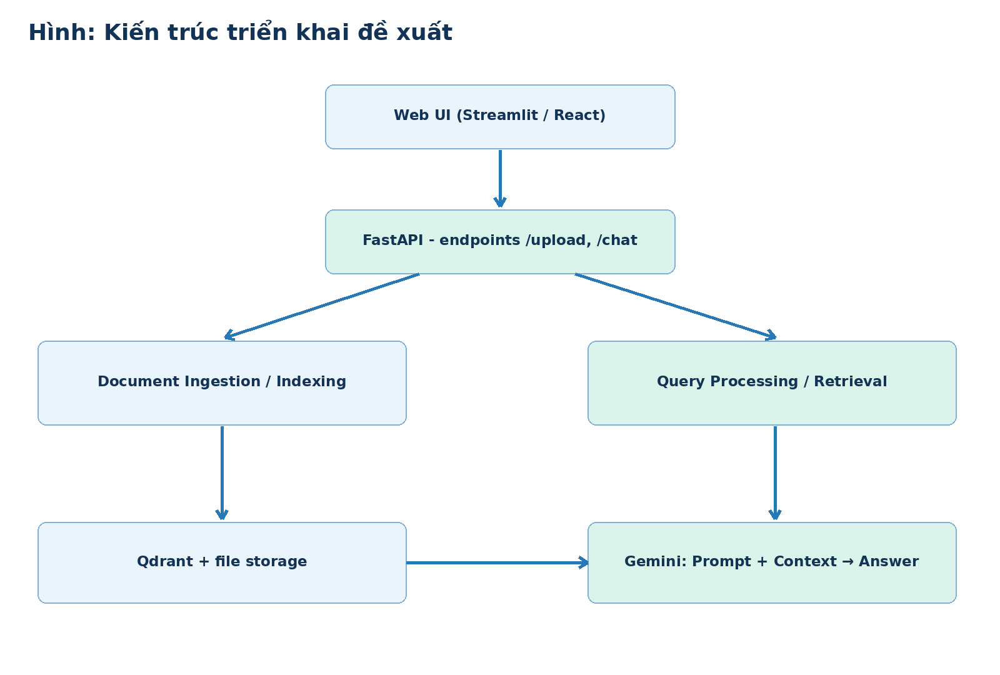

# Trợ Lý Rô AI — RAG Chat Assistant

**Tên đề tài:** Nghiên cứu và xây dựng hệ thống hỏi đáp tài liệu thông minh sử dụng Retrieval-Augmented Generation (RAG).

**Phạm vi:** Prototype phục vụ đồ án IT Project, định hướng hỏi đáp Student Handbook và tài liệu học tập. Repo cung cấp báo cáo tháng 8–9 và bộ mã thử nghiệm từ nguồn làm việc đã có; **chưa phải sản phẩm hoàn chỉnh**.



## Công nghệ dự kiến

- **Python**, Recursive Chunking; Embedding nghiên cứu chính: **BGE-M3**.
- Demo mặc định chạy **multilingual MiniLM** để nhẹ hơn trên CPU, **Qdrant in-memory**, Dense Top-K.
- **Gemini API** tùy chọn (cần API key và quota).
- **OCR, upload PNG/JPG, FastAPI, hybrid/reranking**: đang nghiên cứu, **chưa tích hợp trong prototype hiện tại**.

## Tiến độ

| Tháng | Nội dung | Tình trạng |
|---|---|---|
| 08/2026 | Đề cương tổng quan, định hướng RAG | Có báo cáo |
| 09/2026 | So sánh Chunking, Embedding, Qdrant; thiết kế và tiêu chí đánh giá | Có báo cáo |
| 10/2026 | Thử nghiệm code Chunking, Embedding, Retrieval | Có mã nguồn demo, chưa xác nhận benchmark thực tế |
| 11/2026 | Mở rộng truy xuất, tích hợp giao diện/API | Dự kiến |
| 12/2026 | Đánh giá, sửa lỗi và hoàn thiện | Dự kiến |

## Thư mục quan trọng

- [`docs/reports`](docs/reports): báo cáo Word tháng 8 và tháng 9.
- [`docs/architecture.md`](docs/architecture.md): kiến trúc và sơ đồ.
- [`docs/research/technology_comparison.md`](docs/research/technology_comparison.md): lập luận lựa chọn công nghệ.
- `main.py`, `src/pipeline.py`: chương trình thử nghiệm retrieval qua tài liệu text/PDF/DOCX.
- `compare_chunking.py`, `cosine_demo.py`, `evaluate.py`: bài thực hành/đánh giá ban đầu.
- `data/sample.txt`: **dữ liệu tổng hợp minh họa**, không phải quy định chính thức của trường.

## Cài và chạy trên Windows (PowerShell)

Yêu cầu Python 3.11 và Git. Tại thư mục gốc project:

```powershell
py -3.11 -m venv .venv
.\.venv\Scripts\Activate.ps1
python -m pip install -r requirements.txt
Copy-Item .env.example .env
python cosine_demo.py
python compare_chunking.py
python -m unittest discover -s tests -v
python main.py --no-llm --question "Sinh viên được mượn bao nhiêu quyển sách?"
```

Lần đầu chạy có thể cần Internet để tải pretrained embedding model. Để dùng Gemini, điền khóa vào `.env` và chạy `python main.py --question "..."`. **Không commit `.env`.**

`config.yaml` là nơi cấu hình không nhạy cảm: chiến lược chunk (`recursive` mặc định hoặc `fixed`), kích thước/overlap theo **ký tự**, `top_k`, và tên model mặc định. Các biến tương thích cũ trong `.env` (`CHUNK_SIZE`, `CHUNK_OVERLAP`, `TOP_K`, `EMBED_MODEL`, `GEMINI_MODEL`) vẫn ghi đè giá trị tương ứng để không thay đổi cách chạy CLI hiện có.

**Lưu ý:** Demo mặc định dùng Qdrant in-memory (không lưu sau khi chương trình kết thúc), PDF dạng text; **không xử lý OCR**. `evaluate.py` chỉ là demo đánh giá mẫu, **không được dùng như số đo khoa học thực nghiệm khi chưa có ground truth chuẩn**. Thay embedding model sẽ cần lập collection mới/re-index phù hợp dimension.

## Hướng dẫn upload GitHub

Xem [`GITHUB_UPLOAD.md`](GITHUB_UPLOAD.md).
