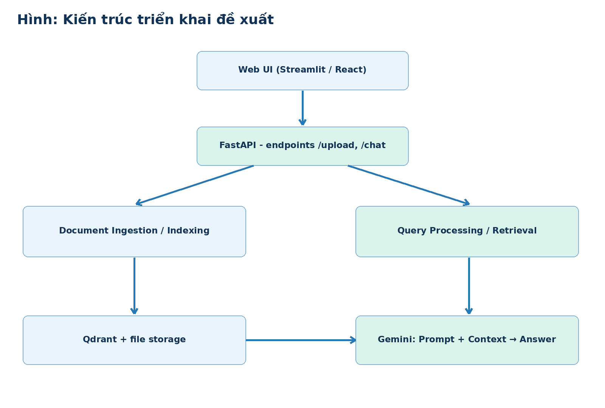
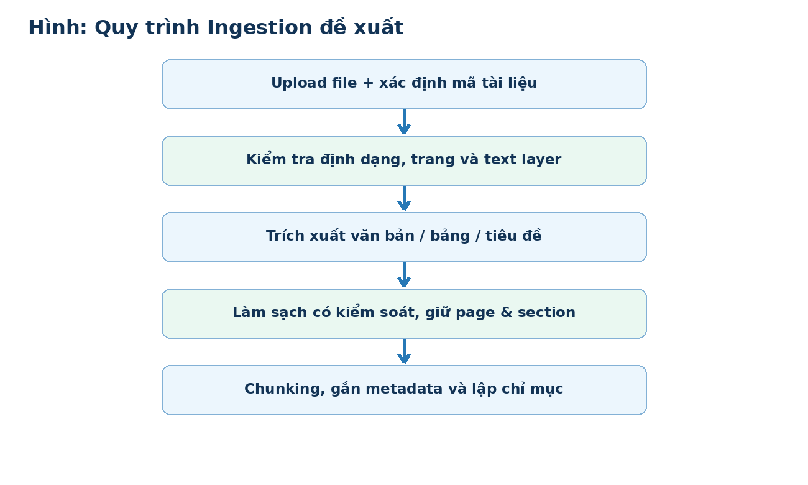
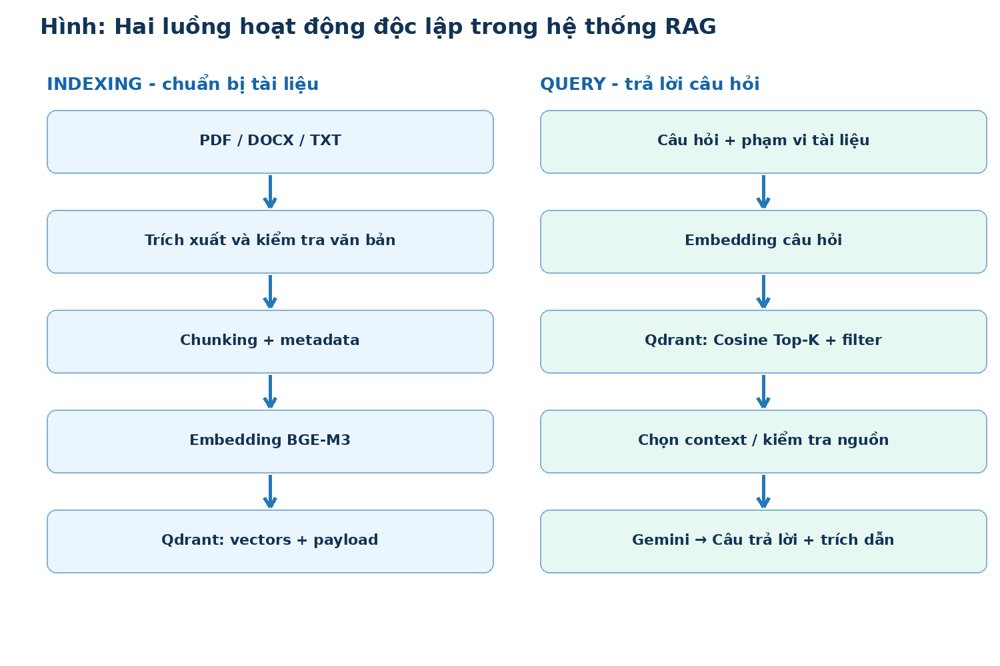
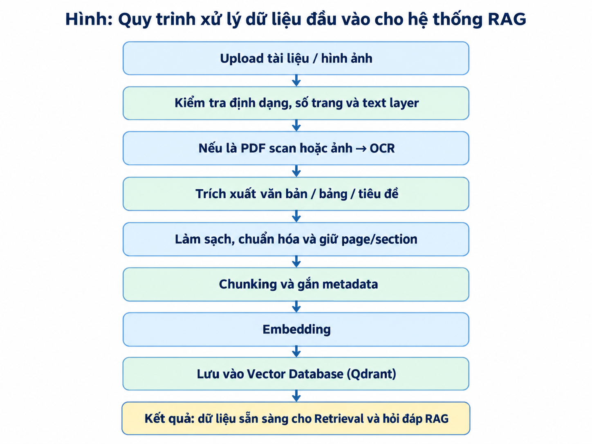

# Kiến trúc đề xuất

## Luồng indexing

Upload PDF/DOCX/TXT → kiểm tra định dạng và quyền truy cập → trích xuất → chuẩn hóa → Chunking → Embedding → Qdrant.

## Luồng query

Câu hỏi → Embedding câu hỏi → Retrieval Top-K → cung cấp context cho Gemini → câu trả lời và tham chiếu tài liệu.

## Hướng nghiên cứu mở rộng

OCR cho PDF scan/ảnh, Reranking, Hybrid retrieval và FastAPI là **định hướng**, chưa được tính là chức năng đã hoàn thành.
